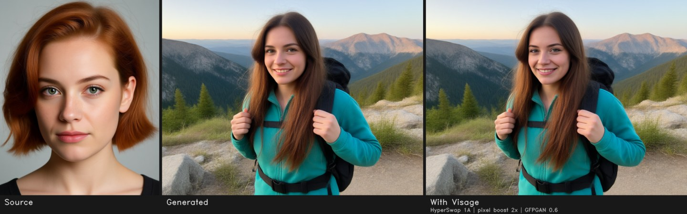
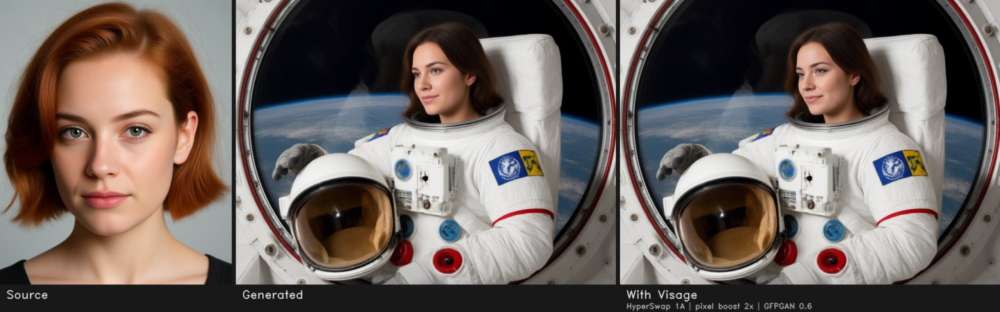
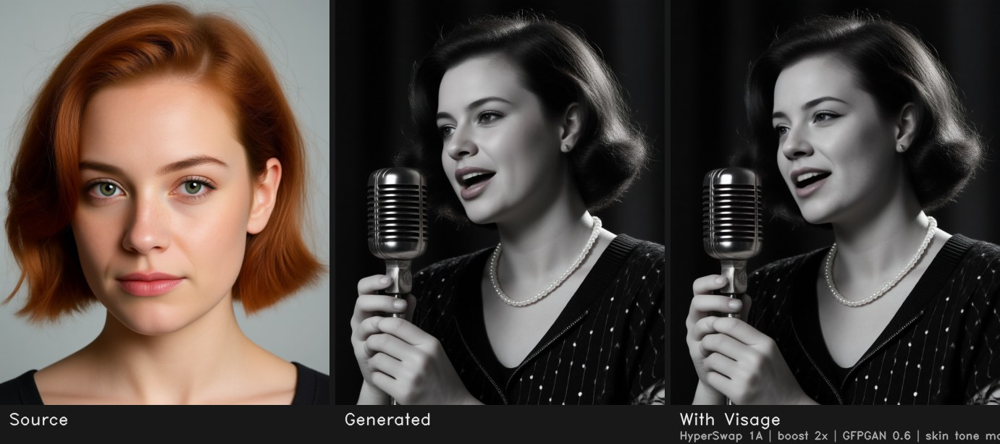
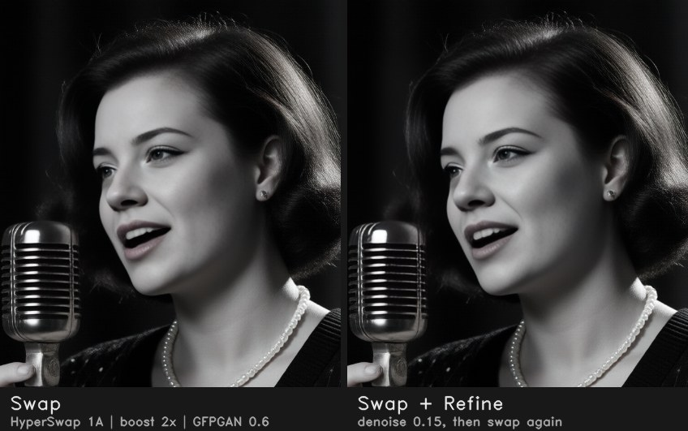
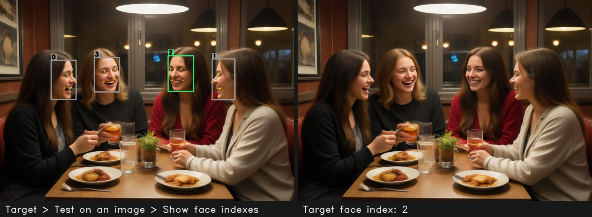

# 🎭 Visage for Forge Neo

<div align="center">

[](https://github.com/Haoming02/sd-webui-forge-classic/tree/neo)
[](https://gradio.app/)
[](https://github.com/eduardoabreu81/visage-forge-neo)

[](LICENSE)

> **Extension for [Stable Diffusion WebUI Forge - Neo](https://github.com/Haoming02/sd-webui-forge-classic/tree/neo)**

</div>

Swap, restore and refine faces inside Forge Neo. Visage works in txt2img, img2img and the Extras tab, using the Generate button you already know.
It is **ONNX only**: there is no insightface, no C++ build tools and no second Python to install, so it runs on the Python 3.13 that Forge Neo ships with.

<p align="center"></p>

> [!Important]
> **Preview.** The pipeline has been tested end to end inside Forge Neo 2.27 (txt2img, img2img, batch, Extras, X/Y/Z, API). So far it has only run on CPU, and NVIDIA GPU testing is next. Please [report what you find](https://github.com/eduardoabreu81/visage-forge-neo/issues).

> [!Note]
> Every face in this README was generated. None of them shows a real person.

---

## 📋 Table of Contents

- [What's New](#-whats-new)
- [Why Visage](#-why-visage)
- [Features](#-features)
- [Installation](#-installation)
- [Recommended Settings](#%EF%B8%8F-recommended-settings)
- [Swap Models](#-swap-models)
- [API](#-api)
- [Tips](#-tips)
- [Responsible Use](#%EF%B8%8F-responsible-use)
- [Credits](#-credits)

---

## 🆕 What's New

### v0.3.0 - Integrity, PNG Info and X/Y/Z

- **Pinned SHA-256 for every model**: a download that does not match is discarded, and **Models → Verify** re-checks the files on disk
- **PNG Info / Send to** restores the Visage panel: swap model, strength, faces, boost, restorer and refine
- **X/Y/Z plot axes**: compare swap models, strength, pixel boost, restorers or refine denoise in one grid

### v0.2.0 - More Swap Models and an Optional SFW Filter

- **AlphaFace, GHOST 1/2/3, SimSwap 256/512 and HiFiFace** join HyperSwap, inswapper and ReSwapper
- **Optional SFW filter**, off by default: when you turn it on, it skips or blurs images that at least two of three NSFW models flag

### v0.1.1 - Previews and Refine Fix

- **Face indexes preview** and **Try swap** on a test image, without generating
- **Swap again after refining**: keeps the identity when the refine pass runs on turbo models
- **Identity match** in the console: how close each swapped face is to its source

### v0.1.0 - First Release

- Face swap, face restore and checkpoint refine for Forge Neo, ONNX only

---

## 💡 Why Visage

The face swap extensions people used with A1111 pin `insightface==0.7.3`, which has a prebuilt wheel only for Python 3.10. Some of them also replace `onnxruntime-gpu` with the CPU build on every start, which breaks other extensions. Visage was written from scratch to avoid both:

- the whole pipeline is plain `onnxruntime` + `numpy` + `opencv`, with no compiler and no insightface
- the installer adds an onnxruntime build **only when none is installed**, and never uninstalls or replaces one
- models download the first time you use them, from their upstream hosts, into `models/visage`

---

## 🎯 Features

### 🔄 Face Swap

<p align="center"></p>

- **14 swap models**: HyperSwap 1A/1B/1C, AlphaFace, inswapper (+fp16), ReSwapper 128/256, GHOST 1/2/3, SimSwap 256/512 and HiFiFace
- **Pixel boost** 1x / 2x / 4x: the swapper runs on sub-pixel tiles, so 128 and 256 px models give a sharper face
- **Identity strength** from 0 (keep the target) to 1 (the source), and up to 1.5 to push the source further
- **Sources**: one picture, several pictures averaged into one identity, or a saved face model
- Swap the generated image, the img2img input before generation, or both

### 🎚️ Masks and Colour

<p align="center"></p>

- **Feathered box** with padding, plus **HyperSwap's own mask**
- **Occlusion** with XSeg, so hands, hair, microphones and glasses stay in front of the face
- **Face parsing regions** (BiSeNet): pick which parts get replaced, such as skin, eyes, nose or lips
- **Keep target mouth** for open mouths, teeth and tongues
- **Match skin tone** to the target, for black-and-white pictures, colour grading or different lighting

### ✨ Restore and Refine

<p align="center"></p>

- **Face restorers**: GFPGAN 1.4, CodeFormer (with fidelity), GPEN-BFR 256/512/1024/2048 and RestoreFormer++. They touch only the faces Visage swapped
- **Face boost**: restore inside the swap crop before pasting it back
- **Refine with the checkpoint**: a low-denoise inpaint of the new face with the model you are using, so the face takes on the picture's lighting, grain and style. It then swaps again to keep the identity

### 👥 Choose Your Faces

<p align="center"></p>

- **Target faces** by index (`0`, `0,2`, `1-3` or `all`), in 7 sort orders
- **Show face indexes** on any test picture, or on the source, before you generate
- **Only gender** (FairFace), minimum face size, and rotated / lying faces
- **Several people at once**: source faces `0,1` go to target faces `0,1` in order

### 🧑 Face Models

- Save the current source as a small `.safetensors` face model and pick it later from a list
- Blend several face models into one
- ReActor face models in `models/reactor/faces` show up in the list too

### 🧪 Try It Before You Generate

- **Target → Test on an image**: drop any picture, see the face indexes, and **Try swap** with the current settings
- The console shows how close each swapped face is to its source (`identity match 0.78`)

### 🧰 Forge Integration

- **Extras tab**: swap or only restore faces on any picture, including batches
- **PNG Info / Send to** restores the Visage settings (the source face is not stored in the picture)
- **X/Y/Z plot** axes: swap model, identity strength, pixel boost, face restorer, restorer visibility, refine denoise and target faces
- **REST API** under `/visage/v1/`

### 🛡️ Safe by Design

- Changes no Forge Neo file; remove the extension and everything is as it was
- Never replaces an onnxruntime build that is already installed
- Every model has a pinned SHA-256; a download that does not match is discarded
- Works with CUDA, ROCm, MIGraphX, DirectML, CoreML or CPU, picked automatically or set in **Settings → Visage**
- **Optional SFW filter**, off by default. With it off, no safety model is downloaded or loaded

---

## 📦 Installation

1. Open Forge Neo WebUI
2. Go to **Extensions** → **Install from URL**
3. Paste: `https://github.com/eduardoabreu81/visage-forge-neo`
4. Click **Install** and restart the WebUI
5. On the first start, Visage checks for onnxruntime:
   - if any onnxruntime build is installed, it is left as it is
   - if none is, Visage installs `onnxruntime-gpu` on NVIDIA, `onnxruntime-directml` on AMD / Intel under Windows, or `onnxruntime` otherwise. Set `VISAGE_ORT_PACKAGE` to choose another package
6. Open the **Visage** accordion in txt2img or img2img. Models download the first time they are needed: about 180 MB for detection and recognition, then the swap model you pick (HyperSwap is 384 MB)

To keep the models somewhere else, start Forge with `--visage-models-dir D:\models\visage` or set the folder in **Settings → Visage**.

> [!Note]
> Tested on Forge Neo 2.27 with Python 3.13.12, numpy 2.3.5 and onnxruntime 1.26 (CPU). NVIDIA GPU (`onnxruntime-gpu`) testing is next.

---

## ⚙️ Recommended Settings

| Goal | Swap model | Pixel boost | Restorer | Other |
| :--- | :--- | :--- | :--- | :--- |
| Natural look (default) | HyperSwap 1A | 2x | GFPGAN 1.4 at 0.6 | |
| Strongest likeness | AlphaFace or inswapper | 2x | GFPGAN 1.4 at 0.6 | |
| Black and white, strong grading | HyperSwap 1A | 2x | GFPGAN 1.4 at 0.6 | Match skin tone |
| Hands or objects over the face | any | 2x | any | Occlusion mask |
| Face looks pasted on | any | 2x | any | Refine, denoise 0.10–0.15 on turbo models, 0.2–0.3 on regular ones |

---

## 🧩 Swap Models

<p align="center"></p>

*Identity is the ArcFace similarity between the swapped face and the source (higher is closer). A higher number is not always the more believable picture: HyperSwap usually looks the most natural.*

| Model | Size | License | Notes |
| :--- | :--- | :--- | :--- |
| HyperSwap 1A / 1B / 1C | 384 MB | ResearchRAIL | natural, keeps expression and lighting, has its own mask |
| AlphaFace 256 | 529 MB | Non-commercial | newest, strong likeness |
| inswapper 128 (+fp16) | 529 / 264 MB | Non-commercial | strongest likeness, softer: use pixel boost 2x |
| ReSwapper 128 / 256 | 528 MB | Non-commercial | keeps more of the target |
| GHOST 1 / 2 / 3 | 491–815 MB | Apache-2.0 | the only swap model with a permissive license |
| SimSwap 256 / 512 | 210 / 228 MB | Non-commercial | |
| HiFiFace 256 | 194 MB | Unknown | keeps face shape |

**Settings → Visage → Models** lists every model with its license and whether it is downloaded.

---

## 🔌 API

The routes are mounted on Forge's FastAPI app:

```
GET  /visage/v1/models
GET  /visage/v1/facemodels
POST /visage/v1/facemodels   {"name": "...", "images": ["<b64>", ...]}
POST /visage/v1/swap         {"target_image": "<b64>", "source_image": "<b64>" | "face_model": "name", "options": {...}}
POST /visage/v1/restore      {"image": "<b64>", "options": {"restorer": "codeformer"}}
POST /visage/v1/detect       {"image": "<b64>", "classify": true}
POST /visage/v1/unload
```

`options` takes the field names of [`lib_visage/pipeline.py`](lib_visage/pipeline.py) `Options`, for example
`{"swapper": "hyperswap_1a_256", "pixel_boost": 2, "target_indexes": "all", "restorer": "gfpgan_1.4", "report_similarity": true}`.

Visage also works in `/sdapi/v1/txt2img` and `/sdapi/v1/img2img` through `alwayson_scripts.Visage.args`, in the order of `ARG_KEYS` in [`scripts/visage.py`](scripts/visage.py).

---

## 💡 Tips

- A clear, front-facing source photo works best. For a stronger identity, use **Multiple images** with 3 to 5 photos of the same face
- Not sure which face is index `1`? Use **Target → Test on an image → Show face indexes**
- With turbo / few-step models, keep the refine denoise low (0.10–0.15) and leave **Swap again after refining** on
- Small faces in wide shots gain the most from pixel boost 2x and a restorer
- **Unload models from memory** in the Models tab frees the memory Visage uses, without restarting Forge

---

## ⚖️ Responsible Use

Face swapping can hurt real people. Only use faces you have the right to use. Do not create non-consensual intimate imagery, impersonate people or make content meant to deceive. In many places this is illegal. Label synthetic media as synthetic.

The **optional SFW filter** (**Settings → Visage**) can skip or blur NSFW results, for shared machines and public demos. It is off by default and does not limit anything while it is off.

---

## 📄 Credits

- **[Forge Neo](https://github.com/Haoming02/sd-webui-forge-classic/tree/neo)** by Haoming02
- **[InsightFace](https://github.com/deepinsight/insightface)**: SCRFD, ArcFace and inswapper
- **[FaceFusion](https://github.com/facefusion/facefusion)** by Henry Ruhs: HyperSwap and the ONNX ports of most models used here
- **[ReSwapper](https://github.com/somanchiu/ReSwapper)**, **[GHOST](https://github.com/ai-forever/ghost)**, **[SimSwap](https://github.com/neuralchen/SimSwap)**, HiFiFace and AlphaFace: the swap models
- **[GFPGAN](https://github.com/TencentARC/GFPGAN)**, **[CodeFormer](https://github.com/sczhou/CodeFormer)**, **[GPEN](https://github.com/yangxy/GPEN)** and **[RestoreFormer++](https://github.com/wzhouxiff/RestoreFormerPlusPlus)**: face restoration
- **DeepFaceLab** (XSeg), **[face-parsing](https://github.com/yakhyo/face-parsing)** by yakhyo (BiSeNet) and **[FairFace](https://github.com/joojs/fairface)**
- **[ReActor](https://codeberg.org/Gourieff/comfyui-reactor-node)** by Gourieff and **[VisoMaster-Fusion](https://github.com/VisoMasterFusion/VisoMaster-Fusion)**: the features the community asked for

Visage is an independent implementation and contains no code from these projects. It does not include any model weights. Each model downloads from its upstream host and keeps its own license, and several are for non-commercial or research use only.

---

## 📜 License

AGPL-3.0 - see [LICENSE](LICENSE)

---

<div align="center">

Made with ❤️ for the Stable Diffusion community

**[Report Bug](https://github.com/eduardoabreu81/visage-forge-neo/issues)** • **[Request Feature](https://github.com/eduardoabreu81/visage-forge-neo/issues)** • **[☕ Ko-fi](https://ko-fi.com/eduardoabreu81)**

</div>
